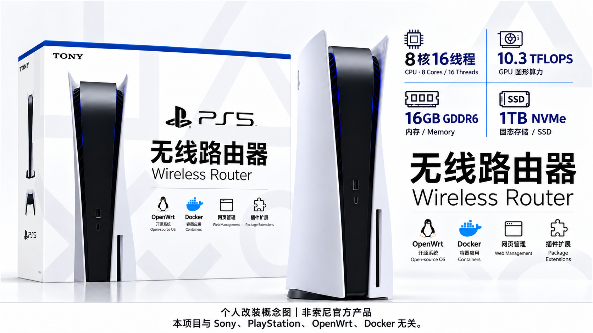

**English** | [简体中文](README.zh-CN.md)

# PS5-OpenWrt

An experimental OpenWrt image that boots from an external drive on **PS5 firmware 13.00**. This repository includes the build scripts, kernel and loader patches, LuCI fan control plugin source, and pinned upstream source revisions used for this release.

**[Download firmware and loader](https://github.com/naojiren/PS5-OpenWrt/releases/tag/v2026.10.20-r1003)** · **[Installation guide](docs/INSTALL.md)** · **[Build notes](BUILDING.md)**

The image above is a personal modification concept, not an official Sony product. Its artwork is illustrative; the actual software and tested features are described below.

## Current release

| Component | Version or configuration |
| --- | --- |
| OpenWrt | 25.12.6, with Chinese LuCI enabled in the image |
| PS5 Linux | 7.1.7-ps5-openwrt, kernel package 7.1.7-r1003 |
| Default theme | Argon 2.4.8 |
| OpenClash | 0.48.002, built from source |
| Mihomo / Meta | 1.19.32, official x86-64 core preinstalled |
| CoreMark | 16 threads by default; does not run at boot |
| Wi-Fi | IW620, CN region, 5 GHz, channel 36, HE80 |
| USB Ethernet | Matching r8152 driver and RTL8156B firmware |
| Fan control | Automatic at boot, default target 80°C; LuCI supports target adjustment and manual full speed |

## Default settings

- Username: `root`; password: `password`; SSH port: `22`.
- The upstream router assigns the management IP through DHCP. Hostname: `PS5-OpenWrt`.
- Fallback address for a direct connection: `172.31.55.1/24`.
- Wi-Fi access point: `PS5-OpenWrt`, enabled by default, with no password.
- Wi-Fi and Ethernet share the same `br-lan` bridge. The PS5 and wireless clients receive addresses from the upstream DHCP server; the PS5's own DHCP server is disabled by default.
- OpenClash and Mihomo are preinstalled. Open **Services → OpenClash** (`服务 → OpenClash` in the default Chinese interface), import your own subscription or YAML configuration, then enable it.

To use the PS5 as a secondary gateway or proxy, set the relevant clients' gateway and DNS to the PS5's address. Connecting to its Wi-Fi alone may still leave the upstream router as the gateway advertised by DHCP.

## Included fixes

1. **PS5 13.00 Wi-Fi firmware extraction:** move the loader's extraction start 160 bytes earlier and verify the firmware record CRC.
2. **Automatic Wi-Fi startup:** recognize NXP's `mwiphy0`, apply the CN region before loading the driver, and include the matching regulatory database and signature.
3. **Kernel bridge support:** enable `CONFIG_BRIDGE_VLAN_FILTERING=y` for compatibility with OpenWrt network management.
4. **MTS Ethernet receive filtering:** backport upstream promiscuous-mode and multicast-filter fixes so the Ethernet port accepts unicast replies addressed to wireless clients behind the bridge.

Wi-Fi association, upstream DHCP leases, and bidirectional traffic have been confirmed on one CFI-2200 B01 console running 13.00. The image passed **37 virtual-machine checks**, including actual Mihomo HTTP proxy forwarding, the OpenClash page, TUN/TPROXY, upstream DHCP bridging, and LuCI fan control endpoints. See the [validation summary](docs/validation-summary.json). VM results do not replace testing physical USB Ethernet adapters, sustained thermal control, or complete proxy subscriptions on a real console.

## Repository layout

- `build-*.sh`, `integrate-*.sh`: staged build and integration scripts used for this release.
- `files/`: default network, wireless, startup service, and other OpenWrt configuration files.
- `fan-plugin/`: LuCI fan control plugin and upstream control-program source.
- `kernel-patches/`, `loader-patches/`: local patches used by this project.
- `source/`: snapshots of the modified MTS and loader files, plus the CoreMark Makefile.
- `upstream/`: PS5 Linux and IW620 patches from pinned revisions.
- `configs/`: the actual kernel and CoreMark configurations.
- `sources.lock.json`: upstream repositories, commits, download URLs, and checksums.
- `keys/`: the APK signing **public key**; no signing private key is included.

This image combines a PS5-specific kernel with official OpenWrt user space. **Do not replace its kernel with a generic x86 firmware image or a generic sysupgrade.** It boots from an external drive; after a cold boot, you must still use your existing jailbreak and Linux loader procedure.

## Upstream projects and licensing

Thanks to [ps5-linux](https://github.com/ps5-linux), [OpenWrt](https://openwrt.org/), [OpenClash](https://github.com/vernesong/OpenClash), [Mihomo](https://github.com/MetaCubeX/mihomo), [NXP mwifiex](https://github.com/nxp-imx/mwifiex), [Argon](https://github.com/jerrykuku/luci-theme-argon), and [CoreMark](https://github.com/eembc/coremark).

The build scripts and fan plugin interface added by this project are released under GPL-2.0-only. Upstream source, patches, kernels, programs, and firmware retain their respective licenses and notices. See [third-party notices](THIRD-PARTY-NOTICES.md).
